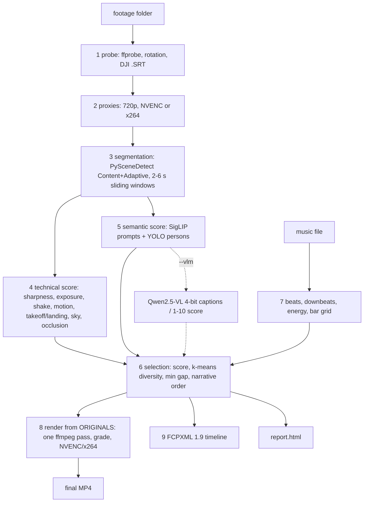

# dronecut

Local, offline automatic highlight editor for drone footage. Point it at a folder of raw clips (e.g. 20-30 minutes
from a DJI Neo), give it a music track, and it produces a 2-3 minute highlight video **cut to the beat**, plus an
editable DaVinci Resolve timeline and an HTML report explaining every choice. No cloud APIs - everything runs on your
machine (GPU optional).

```
dronecut analyze  D:\footage\2026-10-04 
dronecut build    --music D:\music\track.mp3 --duration 150
```

Outputs (in `output/`): `dronecut_highlight.mp4`, `dronecut_highlight.fcpxml` (opens in Resolve and references your
**original** files), `report.html` (thumbnails + scores of selected / rejected windows with reasons), `build.json`.

## How it works



Every stage is cached under `.dronecut_cache/` (keyed by file path/size/mtime and the relevant settings), so
re-running only does the missing work. Hard-reject thresholds are applied at *selection* time, so tuning them in
`config.yaml` never needs re-analysis.

* **Cut points snap to the music.** Beats come from librosa; for steady tempos a regular grid is fitted by regression
  (sub-frame accurate, fills sparse intros) and the phase is locked to the kick drum. Downbeats are found from the
  low-frequency accent pattern. Each shot is 1 / 2 / 3 bars long depending on the energy of that section (short cuts
  on high energy, long on calm). The video is trimmed to exact frame counts from cumulative bar boundaries, so it
  cannot drift against the music. The edit ends on a bar boundary with a fade-out.
* **Junk rejection** (no AI): blurry, over/under-exposed, shaky or jerky, static or chaotic, rapid zoom,
  takeoff/landing (start-of-clip receding / end-of-clip approaching ground; optionally an altitude floor from the `.SRT`, off by default so low, close-to-people flying is kept),
  sky-only, occluded (finger/propeller). All thresholds are in `config.yaml`.
* **Semantic scoring**: SigLIP (`google/siglip-so400m-patch14-384`) image embeddings vs. positive / negative text
  prompts, YOLOv8n person detection boost. `--fast` replaces both with cheap stand-ins (colour-layout embedding,
  no person detector) for CI and quick looks.
* **Diversity & narrative**: k-means clusters on the embeddings with a per-cluster cap, a minimum time gap between
  picks from the same clip, chronological order, opening with the most "wide establishing" strong shot and closing
  with a pull-away shot if there is one.
* **`--vlm`** (off by default): Qwen2.5-VL-7B-Instruct in 4-bit (fits 12 GB; Moondream2 fallback) captions the top
  ~40 candidates and gives a 1-10 interestingness score that is blended into the ranking. Models are loaded one at a
  time and VRAM is freed in between.

## Install

Requirements: Python 3.11+, **ffmpeg + ffprobe on PATH** (NVENC build recommended), optionally an NVIDIA GPU.

**Windows (native)**
```powershell
winget install Gyan.FFmpeg                       # or: choco install ffmpeg
py -3.12 -m venv .venv ; .\.venv\Scripts\Activate.ps1
pip install -r requirements.txt
pip install -r requirements-ml.txt               # optional: PyTorch CUDA 12.4 + SigLIP/YOLO/VLM stack
pip install -e .
```

**WSL2 / Ubuntu**: `sudo apt install ffmpeg libsndfile1 python3-venv`, then the same pip commands. For GPU inside
WSL2 install the NVIDIA Windows driver (CUDA is passed through); NVENC availability in WSL2 depends on the ffmpeg build -
dronecut tests for it and falls back to libx264 automatically.

**CPU only**: skip `requirements-ml.txt` (or install the CPU torch wheel) and use `--fast`, or set
`semantic.backend: mock`. Everything works, just without semantic scoring.

Models download on first use into `%LOCALAPPDATA%\dronecut\models` (or `~/.cache/dronecut/models`), never into the repo.

## Usage

```
dronecut analyze <footage_dir> [--fast] [--vlm]
dronecut build --music <file|auto> --duration 150 [--res 1080|2160] [--vlm] [--seed N] [-o output_dir]
dronecut report            # regenerate report.html from the last build
dronecut clean-cache
```
`--music auto` picks from `paths.music_dir` (long enough, tempo in `music.auto_prefer_bpm`). `--seed` makes the whole
run deterministic. `--config path.yaml` selects a config (default: `./config.yaml`); start from `config.example.yaml`.

## Web interface (`dronecut ui`)

```
dronecut ui            # opens http://127.0.0.1:8765 in your browser
```
Control everything from the browser, with local folders: pick the footage / music / output folders (built-in folder
browser), tick which clips to use (thumbnails + preview), preview tracks and see their BPM, change every setting
(length, resolution, cut speed, crossfade, telemetry HUD, quality filter, AI prompts, ...), run Analyze / Build with a
live log and a cancel button, watch the result, open the report and star the parts you must have, then build again.
Settings are saved in `ui_settings.json`; your `config.yaml` is only read. The server listens on `127.0.0.1` only and
needs a per-run token (cookie), a local Host header and a custom header on every write, so other web pages cannot
drive it. Jobs run the normal CLI in the background, so the CLI and the UI always agree.

## Pick the parts you must have

`report.html` has a ⭐ *must have* and a 🚫 *never* button on every thumbnail. Click, then **Download must_have.json**,
save it next to `config.yaml` and re-run `dronecut build ...` (it is picked up automatically, or pass `--must-have FILE`).
Must-have parts override the quality filter and are placed on the beat; if the music is too short they win over ordinary
shots. For any time range, without the report:

```
dronecut build --music auto --include "0010@1:05-1:12" --include "DJI_20261004142928_0015_D.MP4@20-26" --exclude 0013
```
The clip is any part of the file name; times are seconds or `m:ss`.

## Telemetry HUD (`--hud`)

With the DJI `.SRT` files next to the clips, `dronecut build --hud` overlays a glass panel with **speed, altitude, climb
rate, distance from take-off, heading, time of day** and a **live flight-path mini-map** (speed/heading/distance are
derived from the GPS track, the SRT has no speed field). It fades in and out at each cut and is composited in the same
ffmpeg pass. Options under `hud:` in `config.yaml`: `style` (`full`/`minimal`), `units` (`metric`/`imperial`),
`position`, `scale`, `accent` colour, `show_map`. Clips without a GPS fix get no HUD.

## Measured performance

Ryzen 5 7600, 32 GB, RTX 3060 12 GB, Windows 11, ffmpeg 9 with NVENC. Input: 16 DJI Neo clips, 18.3 min
(mixed 3840x2160 @ 29.97 and 1920x1080 @ 59.94, HEVC); output: 148.6 s 1080p, 41 cuts on a 105 BPM track.

| stage | cold run | warm (cached) |
|---|---|---|
| probe | 1 s | 0 s |
| 720p proxies (NVENC, 4 parallel) | 207 s | 0 s |
| scene detection + technical scoring (4 processes) | 66 s | 0.1 s |
| semantic: SigLIP so400m + YOLOv8n (GPU) | 64 s (+ one-time model download) | 2 s |
| VLM, 40 candidates (Qwen2.5-VL-7B 4-bit) | ~11 min incl. ~16 GB first download | 0 s |
| music analysis (`--music auto`, 25 tracks) | 61 s | 0.1 s |
| selection | 1 s | 1 s |
| render 148.6 s from the 4K/1080p originals (NVENC) | 60-80 s | |
| FCPXML + report.html | 12 s | |

## Tuning with real footage

1. Run `dronecut build ...` then open `report.html`. Rejected windows are listed with their reason.
2. Good shots rejected as `shaky`/`sudden_jerk`? raise `tech.shake_max` / `tech.jerk_max`. Too much wobble kept? lower them.
3. `static` rejecting slow orbits? lower `tech.motion_min`. `blurry`: lower `tech.min_sharpness_rel`.
4. Takeoff/landing leaking through: raise `tech.edge_s`, lower `tech.edge_zoom_rate`; with `.SRT` files next to the clips,
   set `tech.min_altitude_m` (e.g. 1.5, needs the `.SRT`) to drop low flying.
5. Not enough variety: more `select.clusters`, larger `select.min_gap_s`. Wrong mood: edit the prompts under `semantic:`.
6. Faster/slower cutting: `music.bars_high/mid/low`. Soft transitions: `render.crossfade_s: 0.4`.
7. Grade: `render.lut` takes a `.cube` file; per-clip exposure/white-balance normalisation is on by default.

## Development

```
pip install -e ".[dev]" && ruff check . && pytest -m "not gpu"
```
Tests generate synthetic clips (1080p + 4K, blurred / shaky / over- / under-exposed / sky-only junk, a multi-scene
clip) and a 120 BPM click track in a temp folder with `scripts/make_test_media.py`; nothing is committed. GPU tests
(`-m gpu`) exercise the real SigLIP / YOLO models and are skipped in CI.

## Known limitations

* Shake detection runs on 10 fps proxies: gentle high-frequency vibration is invisible, big jitter and jerks are caught.
* Takeoff/landing detection is heuristic (zoom direction near clip edges + optional SRT altitude).
* Downbeat detection assumes a steady 4/4 groove; music with free tempo falls back to the tracked beats.
* Source audio mixing (`render.mix_source_audio`) is basic ducking; use with `crossfade_s: 0`.
* HDR / D-Log footage is not tone-mapped; use `render.lut` for a log-to-Rec.709 LUT.

MIT licensed.
